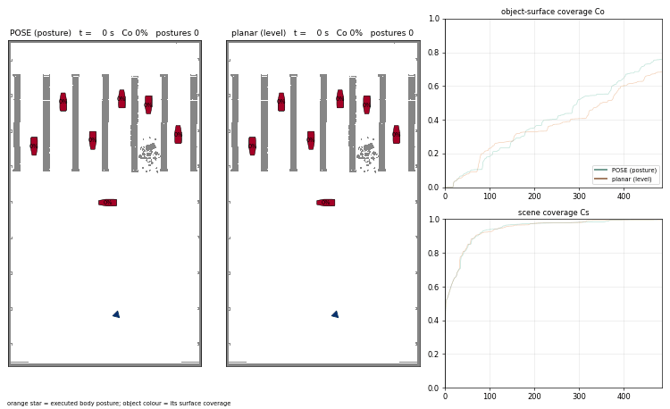
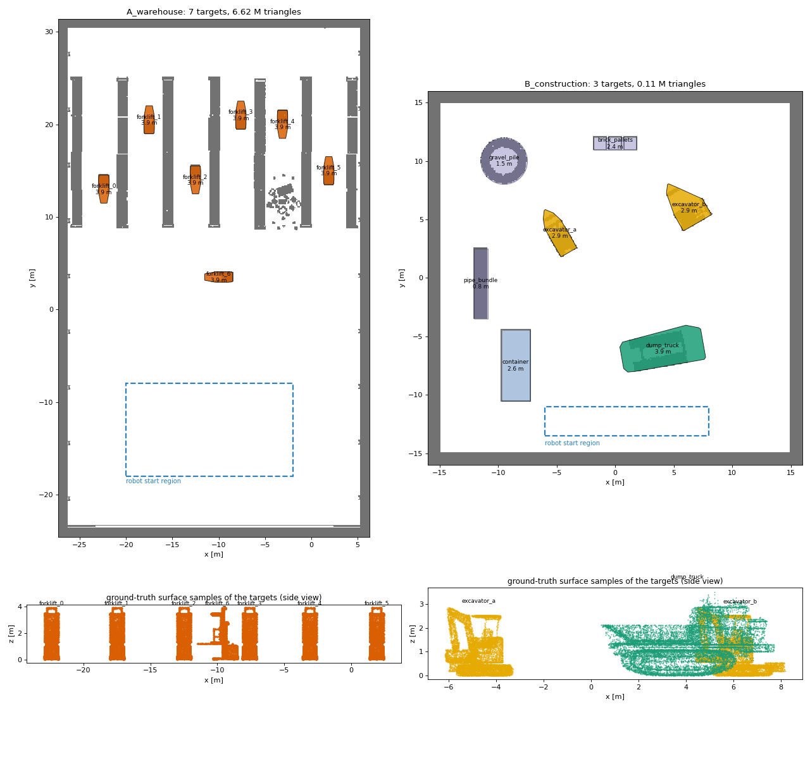
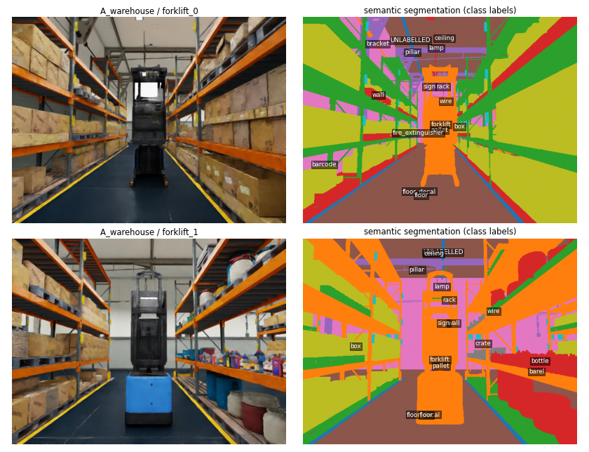
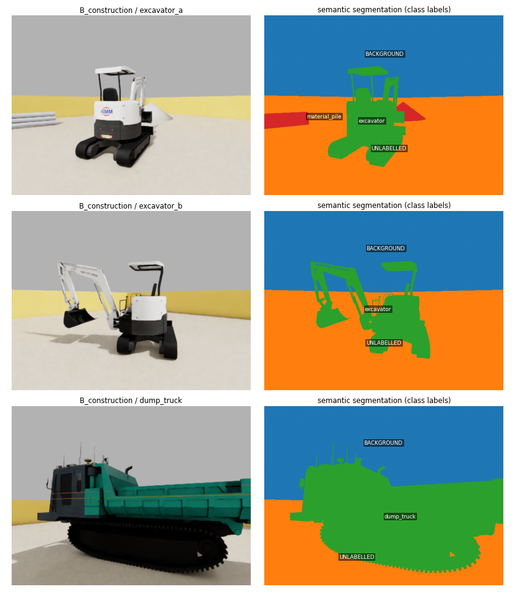
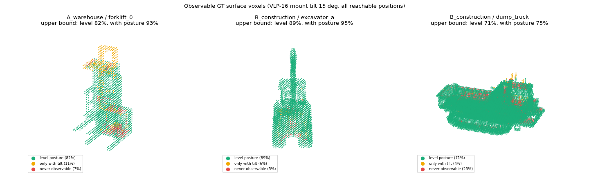
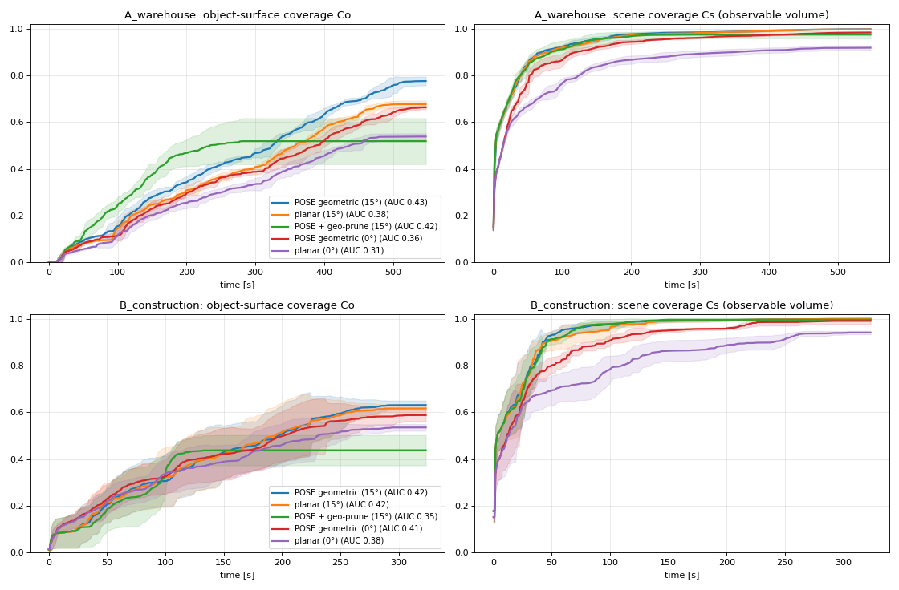
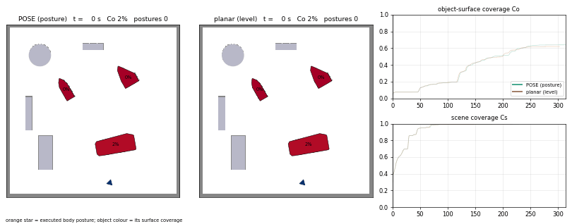
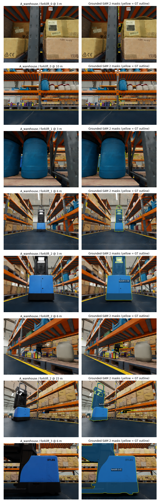

# 3DOG-POSE: 몸을 기울여 장비를 스캔하는 4족 로봇

연세대 PRAXIS 실전문제연구팀 **3DOG** · `pose-inspection` 브랜치 · 진행 중 (2026-10-15 03:50 기준)

Unitree Go2 + VLP-16 라이다가 **처음 보는 현장**을 탐사하면서, 발견한 장비(지게차·굴착기·덤프트럭)의 표면을
**몸의 pitch / roll을 바꿔 가며** 빠짐없이 스캔한다. CMU의 **POSE** (arXiv 2609.19460)를 Isaac Sim에서 우리 조건
(Go2 자세 보행 정책, VLP-16 ±15°, 건설장비)으로 재현하고, 우리 가설인 **"장비 종류별 형상 사전지식이 박스 부풀림보다
낫다"**를 검증한다. 실로봇은 다루지 않고 전부 시뮬레이션이다.



*창고, 같은 시작점. 왼쪽 POSE 방식(정지 지점에서 몸을 기울임, 주황 별 = 자세 실행), 오른쪽 수평 자세만. 지게차 색 =
표면 커버리지. (키네마틱 엔진 그림, 아래 표는 Isaac Go2 결과)*

## 진행 현황

| 단계 | 내용 | 상태 | 핵심 결과 |
|---|---|---|---|
| 0 | 현황 파악 | 완료 | 기존 자세 스캔은 경로 고정 → 자세 효과 +1 %p |
| 1 | 장면 두 개 + 정답 라벨 | 완료 | 창고(지게차 7대, 3.93 m) · 공사장(굴착기 2, 덤프트럭 1, 자재) |
| 2 | 평가 지표 + 이론 상한 | 완료 | 지게차: 수평 82 % → 자세 포함 **93 %**까지 볼 수 있음 |
| 3 | POSE 방식 플래너 (VLM 없이) | 완료 | 창고 Co **0.68 → 0.78 (+10 %p)**, AUCo 0.38 → 0.43 |
| 4 | 인식기 교체 (Grounded-SAM 2) | 실험 중 | 창고 Co 0.72 (정답 0.78), 가설 묶기 오류 수정 후 재실행 중 |
| 5 | 로컬 VLM 가지치기 (Qwen3-VL-8B) | 실험 중 | 응답 2 s·오류 0, 그대로는 가지치기 안 함 → 안전장치 강제 v3 |
| 6 | 장비 형상 사전지식 (우리 기여) | 실험 중 | 템플릿 / CAD 구현, 비교 진행 중 |

---

## 1. 장면



| 장면 | 대상 | 비고 |
|---|---|---|
| **A. Isaac 창고** (31.6 × 54 m) | 지게차 7대 (Isaac ForkliftB, 리프트 1 m 올림 → **3.93 m**) | POSE 창고와 같은 조건 (3.9 m 지게차 7대, 4 m 통로) |
| **B. 공사장** (30 × 30 m, 펜스) | 굴착기 ix35e 2대 (기본 / 상부 90° 회전), 덤프트럭 IC120 | 자재 더미·컨테이너는 비대상 장애물 |

- 대상마다 `UsdSemantics` **class 라벨** → 카메라 정답 분할, 구운 라이다 메시에는 **삼각형별 물체 ID** → 라이다 점의 정답 분할
- 정답 표면 = 메시를 2 cm 간격으로 균일 샘플 → **0.1 m 표면 복셀** (Co의 분모)

 

## 2. 평가 지표와 이론 상한

POSE와 같은 정의: **Co(t)** 표면 커버리지, **Cs(t)** 장면 부피 커버리지, **AUCo** (같은 장면 비교 실행 중 가장 긴 시간 T로
정규화), t_eff · L_eff · N_post. 추가로 **이론 상한**: 도달 가능한 모든 위치(0.5 m 격자) × 8방향 × 자세 15개에서 볼 수 있는
표면 비율.



| 장면 / 대상 | 라이다 0° 수평 | 0° 자세 포함 | **15° 수평** | **15° 자세 포함** |
|---|---|---|---|---|
| 창고 지게차 | 0.58 | 0.93 | 0.82 | 0.93 |
| 공사장 굴착기 | 0.75 | 0.95 | 0.89 | 0.95 |
| 공사장 덤프트럭 | 0.58 | 0.75 | 0.71 | 0.75 |

자세가 필요한 몫은 **높은 지게차**에서 크고(15° 장착에서도 11 %p), 덤프트럭은 적재함 안쪽·하부 25 %가 어떤 자세로도 안 보인다.

## 3. POSE 방식 플래너 (VLM 없이) — Isaac Go2, 6 seeds

장비를 발견하면 주변 **부채꼴 8구역 × 거리 {3, 4, 5} m**에 후보 → 가시성 점수(지금까지 본 장비 복셀까지 ray cast) →
구역별 최고 후보 → **자세 이득 G** (부풀린 박스 δb = 0.5 m 안의 미관측 복셀을 기울인 VLP-16이 몇 개 닿는가, G > G0일
때만 기울임) → 프런티어 시점과 함께 TSP(탐욕 + 2-opt). 자세는 Go2 자세 보행 정책이 학습한 범위
(pitch ±25°, roll ±15°)로 제한.



**A. 창고** (T = 548 s)

| 방법 | AUCo ↑ | t_eff [s] | L_eff [m] | N_post | Co ↑ | Co / 상한 ↑ |
|---|---|---|---|---|---|---|
| **POSE 방식 (15°)** | **0.43 ± 0.01** | 520 ± 20 | 205 ± 14 | 12.7 ± 2.3 | **0.78 ± 0.02** | **0.83 ± 0.02** |
| 수평만 (15°) | 0.38 ± 0.01 | 488 ± 14 | 196 ± 8 | 0 | 0.68 ± 0.02 | 0.72 ± 0.02 |
| POSE + 기하 가지치기 (15°) | 0.42 ± 0.07 | 223 ± 54 | 116 ± 27 | 6.0 ± 2.6 | 0.52 ± 0.11 | 0.56 ± 0.12 |
| POSE 방식 (0°) | 0.36 ± 0.01 | 521 ± 23 | 200 ± 14 | 20.2 ± 1.7 | 0.66 ± 0.01 | 0.71 ± 0.01 |
| 수평만 (0°) | 0.31 ± 0.02 | 495 ± 26 | 203 ± 20 | 0 | 0.54 ± 0.02 | 0.58 ± 0.02 |

**B. 공사장** (T = 323 s)

| 방법 | AUCo ↑ | t_eff [s] | L_eff [m] | N_post | Co ↑ | Co / 상한 ↑ |
|---|---|---|---|---|---|---|
| POSE 방식 (15°) | 0.42 ± 0.09 | 300 ± 19 | 112 ± 14 | 6.7 ± 2.9 | 0.63 ± 0.02 | 0.78 ± 0.03 |
| 수평만 (15°) | 0.42 ± 0.09 | 290 ± 21 | 111 ± 14 | 0 | 0.62 ± 0.02 | 0.77 ± 0.02 |
| POSE + 기하 가지치기 (15°) | 0.35 ± 0.07 | 134 ± 21 | 65 ± 7 | 4.5 ± 3.8 | 0.44 ± 0.07 | 0.54 ± 0.09 |
| POSE 방식 (0°) | 0.41 ± 0.08 | 290 ± 12 | 101 ± 12 | 10.3 ± 3.6 | 0.59 ± 0.03 | 0.73 ± 0.03 |
| 수평만 (0°) | 0.38 ± 0.06 | 278 ± 20 | 104 ± 15 | 0 | 0.54 ± 0.02 | 0.66 ± 0.02 |

**읽는 법**
- 창고에서 자세 선택이 Co를 **+10 %p** 올린다 (POSE 논문 +8–10 %p와 같은 경향). 라이다 0° 장착이면 +12 %p.
- 공사장 15°에서는 차이가 없다: 굴착기 높이 2.86 m는 15° 장착 + 3–5 m 거리에서 이미 보이고, 상한 차이도 4–6 %p뿐.
- **기하 가지치기**(G* < 40이면 구역 건너뜀)는 시간을 절반 이하로 줄이지만 Co가 크게 떨어진다: 장비 모델이 부분적일 때
  박스가 작아 "더 볼 게 없다"고 잘못 판단한다. → 5단계(VLM), 6단계(형상 사전지식)가 겨냥하는 지점.
- GT 장애물과의 충돌 0 s, 넘어짐 0회 (36개 실행 전부).



## 4. 인식기 교체: Grounded-SAM 2 (진행 중)

로봇 둘레 핀홀 카메라 4대(90°씩) → Grounding DINO(base) + SAM 2.1(large) → 라이다 점을 마스크에 투영(깊이로 가림 판정,
마스크 가장자리 2 px 침식, 바닥 반사점 제외) → 공간 묶음 + **다수결 클래스**로 물체 가설 (정답 ID 사용 안 함).
Co는 인식기가 붙인 클래스가 맞을 때만 센다.

**프롬프트 연구** (로봇 높이 카메라, 대상마다 8방향 × 3/6/10/15 m, [표 전체](results/pose_inspection/stage4_prompt_study.md))

| 클래스 | 단어 (단독) | 검출률 | 이미지당 오검출 |
|---|---|---|---|
| 지게차 | forklift / reach truck / industrial vehicle | 0.46 / 0.49 / 0.52 | 0.08 / 0.46 / 0.69 |
| 굴착기 | excavator / digger | 0.81 / 0.83 | 0.53 / 0.55 |
| 덤프트럭 (IC120 크롤러) | dump truck / crawler carrier | 0.81 / 0.79 | 0.85 / 0.93 |

단어를 **따로** 물으면 "excavator"가 크롤러 덤프트럭에도 박스를 친다(43장 중 35건). 공사장 두 클래스를 **한 질의
"excavator . tracked dump truck ."**에 넣으면 굴착기→덤프트럭 오인이 3건으로 줄고 덤프트럭 검출이 16 → 34/43으로 오른다.
6개 단어를 한 질의에 몰아넣으면 점수가 나뉘어 거의 아무것도 안 잡힌다.

**첫 실험 (v0, Isaac 6 seeds) — 무엇이 깨졌나**

| 장면 | 라벨 | Co | t_eff [s] | N_post | 라이다 점 라벨 정밀도 / 재현율 |
|---|---|---|---|---|---|
| 창고 | 정답 (3단계) | 0.78 ± 0.02 | 520 ± 20 | 12.7 | – |
| 창고 | Grounded-SAM 2 v0 | 0.72 ± 0.04 | 1032 ± 100 | 23.5 | 지게차 0.60 / 0.77 (오검출은 전부 배경: 선반·상자) |
| 공사장 | 정답 (3단계) | 0.63 ± 0.02 | 300 ± 19 | 6.7 | – |
| 공사장 | Grounded-SAM 2 v0 | 0.34 ± 0.12 | 378 ± 71 | 8.2 | 덤프트럭 0.42 / 0.92, 굴착기 0.81 / 0.11 |

마스크 자체는 정확했다(아래 그림, 노란 선 = 정답). 문제는 **물체 가설 묶기**였다: "가설 박스에서 1.5 m 안이면 합류" 규칙이
연쇄적으로 번져 공사장에서는 가설 하나가 덤프트럭·굴착기·자재까지 삼켰고(다수결로 굴착기가 "덤프트럭"이 되어 굴착기
Co 0.01 / 0.05), 창고에서는 선반 위 오검출이 가짜 지게차 가설을 만들어 시간이 두 배가 됐다. → 클래스별 최대 크기로 가설
성장을 막고 덤프트럭 임계값을 0.40으로 올려 **두 장면 다시 실행 중**.



## 5. 로컬 VLM 가지치기 (진행 중)

Qwen3-VL-8B-Instruct를 같은 프로세스의 별도 스레드에서 비동기로 돌린다. 장비마다 세션: 위에서 본 지도 크롭(번호 붙인
후보) + 구역 사진 최대 3장(이미 스캔한 부분 초록 틴트) + 후보 표 → `{"green_fraction", "keep", "confidence", "reason",
"done"}`. VLM은 후보만 고르고 각도·거리는 항상 3단계 기하 계산. 응답 시간만큼 시뮬레이션 시간이 지난 뒤에 판단이
적용되고, 그동안 로봇은 이전 판단으로 계속 움직인다. 실패·저신뢰·만료 시 "구역마다 최고 후보"로 돌아간다.

| 버전 | 장면 | Co | t_eff [s] | 구역 방문 | VLM | 문제 → 수정 |
|---|---|---|---|---|---|---|
| v0 | 공사장 | 0.64 | 387 | 24 (전부) | 170회, 2.1 s | 방문마다 판단 만료 → 매번 다른 3개 → 결국 전부 방문 · POSE처럼 "남긴 구역 다 돌면 종료/재질의" |
| v1 | 공사장 | 0.63 | 361 | 17–24 | 75회, 2.3 s | 사진이 3 m 근접샷, 초록은 점무늬 → "대부분 초록" 판단 불가 · 4–8 m 사진, 면으로 칠한 틴트 |
| v2 | 창고 | 0.79 | 655 | 32–35 (전부) | 198회, 2.1 s, 오류 0 | 8B 모델이 "done"을 거의 안 함 (198회 중 5) · 모델이 낸 green_fraction ≥ 0.5면 코드가 "1개만 남기고 종료" 강제 |

로컬 VLM은 안정적(오류 0, 응답 2–3 s, 실행당 토큰 14–34 k)이지만, 그대로는 **가지치기를 거의 하지 않는다**. POSE는
GPT-5.4 + 프롬프트 안전장치로 이를 해결했는데, 8B 모델에서는 안전장치를 구조화된 출력으로 바꿔 코드에서 강제해야 한다.
v3로 두 장면 다시 실행 중.

## 6. 장비 형상 사전지식 (진행 중)

자세 이득을 세는 "아직 안 본 부분이 있을 영역"을 바꿔 끼운다: 박스 부풀림(POSE) / **클래스 템플릿**(굴착기 하부·상부·붐
범위, 지게차 마스트 높이, 덤프트럭 적재함을 상자 조합으로; 하부 방향은 낮은 복셀 PCA, 붐 방향은 높은 복셀 또는 VLM이
첫 사진에서 읽음) / 정확한 CAD(상한).

---

## POSE와 다른 점

| 항목 | POSE | 여기 | 이유 |
|---|---|---|---|
| 로봇 | 키네마틱 Spot, ±30° / ±20° | Isaac Go2 + 자세 보행 정책, ±25° / ±15° | 정책 학습 범위 |
| 라이다 | ±22.5° | VLP-16 ±15° (15° 기울여 장착, 0°는 비교군) | 실제 장비 |
| 종료 | Cs > 90 % & 30 s 정체 | 같은 조건 + **플래너에 남은 목표 없음** | 트인 공사장은 Cs가 1분 만에 포화 |
| Cs 분모 | 전체 복셀 | 관측 가능한 부피 (상한 계산으로 구함), 원래 값도 기록 | 막힌 내부 제외 |
| 물체 발견 | d_max 6 m | 발견 20 m (모델·시점 생성), Co는 6 m 이내 반사점만 | 트인 현장에서 6 m 안에 안 들어가면 장비를 못 찾음 |
| VLM | GPT-5.4 API + heartbeat | 로컬 Qwen3-VL-8B, 방문·만료 시 재질의 | API 미사용 조건 |
| 라이다 | Isaac 센서 | 같은 패턴을 warp로 직접 ray cast (삼각형 ID → 정답 분할) | 정확한 GT 분할 |

## 실행

```bash
conda activate isaac && cd sim
scripts/pose_inspection/fetch_assets.sh Assets/Isaac/6.1/Isaac/Robots/IsaacSim/ForkliftB/   # Isaac 에셋 받기
python scripts/pose_inspection/build_scenes.py                     # 1단계: 장면 생성
python scripts/pose_inspection/compute_upper_bound.py              # 2단계: 이론 상한
python scripts/pose_inspection/run_isaac.py --exp exp/pose.yaml --scene A_warehouse   # 3단계 (6 seeds 병렬)
scripts/pose_inspection/run_isaac_batch.sh "pose planar" "A_warehouse B_construction"
python scripts/pose_inspection/aggregate.py --engine isaac --conds pose planar --name stage3
python scripts/pose_inspection/run_kinematic.py --exp exp/pose.yaml --scene B_construction  # 빠른 개발용 엔진
```

모든 파라미터는 [`configs/pose_inspection/`](configs/pose_inspection/) YAML (`base.yaml` + 장면 + `exp/` 조건별 덮어쓰기).

| 경로 | 내용 |
|---|---|
| `go2_lab/pose_inspection/` | scene_builder · raycast · metrics · upper_bound · mapping · viewpoints · navigation · agent · session · kinematic · isaac_env · perception · vlm · vlm_pruner · priors |
| `scripts/pose_inspection/` | 장면 생성, 상한, 실행(키네마틱 / Isaac), 집계, 프롬프트 연구, GIF |
| `results/pose_inspection/` | 단계별 JSON · 표(md) · 그림, 실행별 seed JSON |

이전 작업(①–⑤ 보행, ARiADNE 탐사 재학습, BIM 사전정보)은 [`bim` 브랜치 README](https://github.com/gkgk0119gmail-arch/3DOG_Go2-exploration/tree/bim).

## 출처

- POSE: Zhan, Chen, Shimada, *Pose-aware Legged Robot Semantic Exploration with Omnidirectional Perception in Confined
  Unknown Environments*, arXiv 2609.19460 (2026)
- Grounding DINO (IDEA-Research/grounding-dino-base), SAM 2.1 (facebook/sam2.1-hiera-large), Qwen3-VL-8B-Instruct
- 장비: ix35e 미니 굴착기 URDF, PWRI IC120 크롤러 덤프트럭 (Apache-2.0), NVIDIA Isaac Sim 창고·ForkliftB 에셋
- [Isaac Lab](https://github.com/isaac-sim/IsaacLab) 3.0, Isaac Sim 6.0.1
