# 3DOG-POSE: 몸을 기울여 장비를 스캔하는 4족 로봇

연세대 PRAXIS 실전문제연구팀 **3DOG** · `pose-inspection` 브랜치 · 진행 중 (2026-10-15 17:00 기준)

Unitree Go2 + VLP-16 라이다가 **처음 보는 현장**을 탐사하면서, 발견한 장비(지게차·굴착기·덤프트럭)의 표면을
**몸의 pitch / roll을 바꿔 가며** 빠짐없이 스캔한다. CMU의 **POSE** (arXiv 2609.19460)를 Isaac Sim에서 우리 조건
(Go2 자세 보행 정책, VLP-16 ±15°, 건설장비)으로 재현하고(1–5단계), 그 위에서 **"어디로 가서 어떤 자세로 볼지"를 정하는
머리를 강화학습(RL)으로** 만든다(7단계). 실로봇은 다루지 않고 전부 시뮬레이션이다.

> **쉽게 말하면** — 로봇을 세 부분으로 나누면 **다리**(걸으며 몸 기울이기) · **눈**(장비 알아보기) · **머리**(다음에 어디로
> 갈지)다. 다리는 이미 RL로 학습된 Go2 자세 보행 정책을 쓴다. 1–5단계는 머리를 POSE 논문처럼 **사람이 짠 규칙**(점수 계산 +
> 최단 순서)으로 만들어 시험장·채점 기준·기준 성능을 세운 것이고, 7단계에서 그 머리를 **RL 정책**으로 바꿔 규칙보다 빨리,
> 빠짐없이 보는지 비교한다.

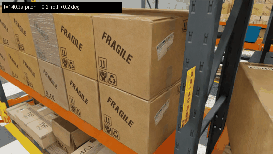

*Isaac Sim, 창고. Go2(자세 보행 정책 + 15° 장착 VLP-16)가 지게차 앞 시점에 도착해 몸을 기울인다
(pitch −25° = 고개 듦, roll ±15°). 기울기는 매 시점에서 "부풀린 박스 안 미관측 복셀에 닿는 수"가 가장 큰 자세로 고른다.*


*창고, 같은 시작점. 왼쪽 POSE 방식(정지 지점에서 몸을 기울임, 주황 별 = 자세 실행), 오른쪽 수평 자세만. 지게차 색 =
표면 커버리지. (키네마틱 엔진 그림, 아래 표는 Isaac Go2 결과)*

## 진행 현황

| 단계 | 내용 | 상태 | 핵심 결과 |
|---|---|---|---|
| 0 | 현황 파악 | 완료 | 기존 자세 스캔은 경로 고정 → 자세 효과 +1 %p |
| 1 | 장면 두 개 + 정답 라벨 | 완료 | 창고(지게차 7대, 3.93 m) · 공사장(굴착기 2, 덤프트럭 1, 자재) |
| 2 | 평가 지표 + 이론 상한 | 완료 | 지게차: 수평 82 % → 자세 포함 **93 %**까지 볼 수 있음 |
| 3 | POSE 방식 플래너 (VLM 없이) | 완료 | 창고 Co **0.68 → 0.78 (+10 %p)**, AUCo 0.38 → 0.43 |
| 4 | 인식기 교체 (Grounding DINO + SAM 2) | 완료 (v4) | 정답 라벨 대비 공사장 0.63 → 0.46, 창고 0.78 → 0.45: 궤도 차량 혼동 + 선반 오검출 = **검출기 한계**, 후처리로는 더 안 줄어듦 |
| 5 | 로컬 VLM 가지치기 (Qwen3-VL-8B) | 완료 (v5) | 공사장: POSE와 같은 AUCo(0.41 vs 0.42)를 **28 % 짧은 시간**에. 창고: AUCo 0.43 → 0.45 |
| 6 | 장비 형상 사전지식 (클래스 템플릿) | 완료 | 박스(POSE)보다 낫지 않음 (키네마틱 · Isaac 모두) → 방향 전환 |
| 7 | **RL 탐사·검사 정책 (머리)** | **Isaac 검증 완료 (학습 계속)** | Isaac Go2 두 장면 **AUCo 1위 (0.50 vs POSE 0.42–0.43)**. 공사장: 같은 Co를 **36 % 짧은 시간**에 |

---

## 1. 장면


| 장면 | 대상 | 비고 |
|---|---|---|
| **A. Isaac 창고** (31.6 × 54 m) | 지게차 7대 (Isaac ForkliftB, 리프트 1 m 올림 → **3.93 m**) | POSE 창고와 같은 조건 (3.9 m 지게차 7대, 4 m 통로) |
| **B. 공사장** (30 × 30 m, 펜스) | 굴착기 ix35e 2대 (기본 / 상부 90° 회전), 덤프트럭 IC120 | 자재 더미·컨테이너는 비대상 장애물 |

- 대상마다 `UsdSemantics` **class 라벨** → 카메라 정답 분할, 구운 라이다 메시에는 **삼각형별 물체 ID** → 라이다 점의 정답 분할
- 정답 표면 = 메시를 2 cm 간격으로 균일 샘플 → **0.1 m 표면 복셀** (Co의 분모)

 

## 2. 평가 지표와 이론 상한

POSE와 같은 정의: **Co(t)** 표면 커버리지, **Cs(t)** 장면 부피 커버리지, **AUCo** (같은 장면 비교 실행 중 가장 긴 시간 T로
정규화), t_eff · L_eff · N_post. 추가로 **이론 상한**: 도달 가능한 모든 위치(0.5 m 격자) × 8방향 × 자세 15개에서 볼 수 있는
표면 비율.


| 장면 / 대상 | 라이다 0° 수평 | 0° 자세 포함 | **15° 수평** | **15° 자세 포함** |
|---|---|---|---|---|
| 창고 지게차 | 0.58 | 0.93 | 0.82 | 0.93 |
| 공사장 굴착기 | 0.75 | 0.95 | 0.89 | 0.95 |
| 공사장 덤프트럭 | 0.58 | 0.75 | 0.71 | 0.75 |

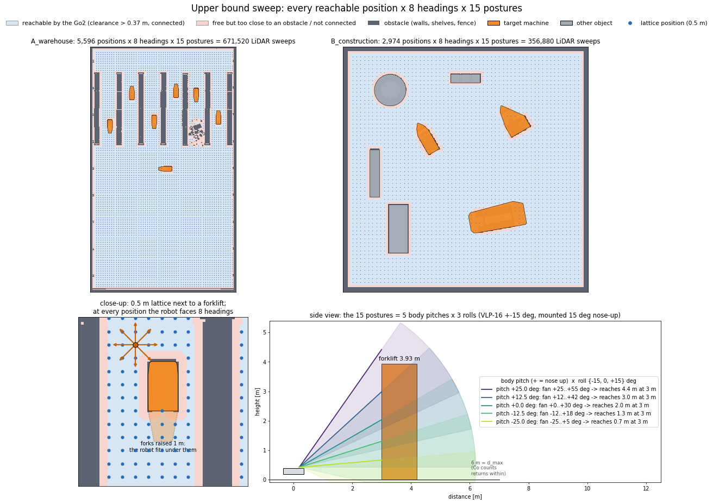

*상한을 어떻게 셌나. 위: 로봇이 실제로 설 수 있는 곳(하늘색: 장애물에서 0.37 m 이상 떨어지고 시작 구역과 이어진 칸,
분홍: 너무 가깝거나 갇힌 칸) 위에 0.5 m 간격 격자점을 찍는다. 창고 5,596개, 공사장 2,974개. 아래 왼쪽: 각 격자점에서 8방향을
본다. 아래 오른쪽: 각 방향에서 몸 자세 15개(pitch 5 × roll 3). 15° 올려 단 VLP-16(±15°)의 부채꼴이 pitch에 따라 위아래로
움직여, 3 m 앞 지게차(3.93 m)의 0.7 m부터 4.4 m 높이까지 닿는다. 이렇게 창고 67만 번, 공사장 36만 번 라이다를 쏴서 한 번이라도
6 m 안에서 맞은 표면을 "볼 수 있는 표면"으로 센다.*

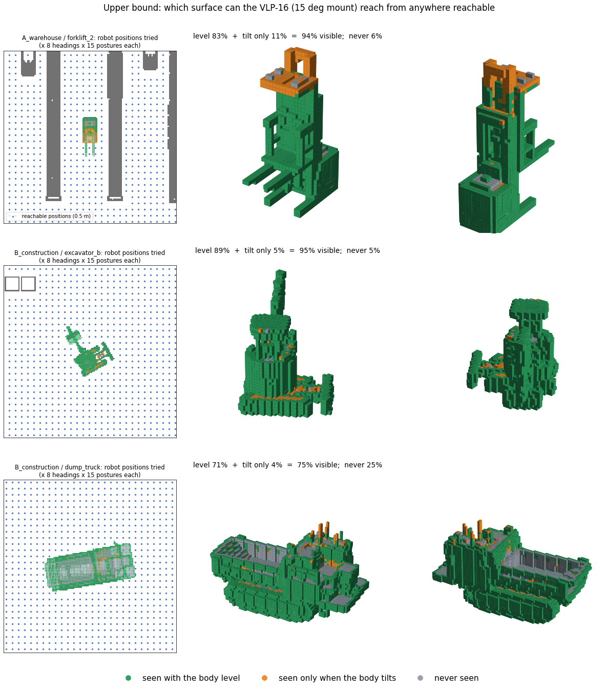

*장비 표면 0.1 m 복셀마다: 초록 = 수평 자세로 보임, 주황 = 몸을 기울여야만 보임, 회색 = 어떤 자세로도 안 보임. 왼쪽 =
로봇이 설 수 있는 0.5 m 격자 위치(각 위치에서 8방향 × 자세 15개). 지게차 마스트 윗면이 주황, 덤프트럭 적재함 안쪽이 회색.*

자세가 필요한 몫은 **높은 지게차**에서 크고(15° 장착에서도 11 %p), 덤프트럭은 적재함 안쪽·하부 25 %가 어떤 자세로도 안 보인다.

## 3. POSE 방식 플래너 (VLM 없이) — Isaac Go2, 6 seeds

장비를 발견하면 주변 **부채꼴 8구역 × 거리 {3, 4, 5} m**에 후보 → 가시성 점수(지금까지 본 장비 복셀까지 ray cast) →
구역별 최고 후보 → **자세 이득 G** (부풀린 박스 δb = 0.5 m 안의 미관측 복셀을 기울인 VLP-16이 몇 개 닿는가, G > G0일
때만 기울임) → 프런티어 시점과 함께 TSP(탐욕 + 2-opt). 자세는 Go2 자세 보행 정책이 학습한 범위
(pitch ±25°, roll ±15°)로 제한.


**A. 창고** (T = 548 s)

| 방법 | AUCo ↑ | t_eff [s] | L_eff [m] | N_post | Co ↑ | Co / 상한 ↑ |
|---|---|---|---|---|---|---|
| **POSE 방식 (15°)** | **0.43 ± 0.01** | 520 ± 20 | 205 ± 14 | 12.7 ± 2.3 | **0.78 ± 0.02** | **0.83 ± 0.02** |
| 수평만 (15°) | 0.38 ± 0.01 | 488 ± 14 | 196 ± 8 | 0 | 0.68 ± 0.02 | 0.72 ± 0.02 |
| POSE + 기하 가지치기 (15°) | 0.42 ± 0.07 | 223 ± 54 | 116 ± 27 | 6.0 ± 2.6 | 0.52 ± 0.11 | 0.56 ± 0.12 |
| POSE 방식 (0°) | 0.36 ± 0.01 | 521 ± 23 | 200 ± 14 | 20.2 ± 1.7 | 0.66 ± 0.01 | 0.71 ± 0.01 |
| 수평만 (0°) | 0.31 ± 0.02 | 495 ± 26 | 203 ± 20 | 0 | 0.54 ± 0.02 | 0.58 ± 0.02 |

**B. 공사장** (T = 323 s)

| 방법 | AUCo ↑ | t_eff [s] | L_eff [m] | N_post | Co ↑ | Co / 상한 ↑ |
|---|---|---|---|---|---|---|
| POSE 방식 (15°) | 0.42 ± 0.09 | 300 ± 19 | 112 ± 14 | 6.7 ± 2.9 | 0.63 ± 0.02 | 0.78 ± 0.03 |
| 수평만 (15°) | 0.42 ± 0.09 | 290 ± 21 | 111 ± 14 | 0 | 0.62 ± 0.02 | 0.77 ± 0.02 |
| POSE + 기하 가지치기 (15°) | 0.35 ± 0.07 | 134 ± 21 | 65 ± 7 | 4.5 ± 3.8 | 0.44 ± 0.07 | 0.54 ± 0.09 |
| POSE 방식 (0°) | 0.41 ± 0.08 | 290 ± 12 | 101 ± 12 | 10.3 ± 3.6 | 0.59 ± 0.03 | 0.73 ± 0.03 |
| 수평만 (0°) | 0.38 ± 0.06 | 278 ± 20 | 104 ± 15 | 0 | 0.54 ± 0.02 | 0.66 ± 0.02 |

**읽는 법**
- 창고에서 자세 선택이 Co를 **+10 %p** 올린다 (POSE 논문 +8–10 %p와 같은 경향). 라이다 0° 장착이면 +12 %p.
- 공사장 15°에서는 차이가 없다: 굴착기 높이 2.86 m는 15° 장착 + 3–5 m 거리에서 이미 보이고, 상한 차이도 4–6 %p뿐.
- **기하 가지치기**(G* < 40이면 구역 건너뜀)는 시간을 절반 이하로 줄이지만 Co가 크게 떨어진다: 장비 모델이 부분적일 때
  박스가 작아 "더 볼 게 없다"고 잘못 판단한다. → 5단계(VLM), 6단계(형상 사전지식)가 겨냥하는 지점.
- GT 장애물과의 충돌 0 s, 넘어짐 0회 (36개 실행 전부).


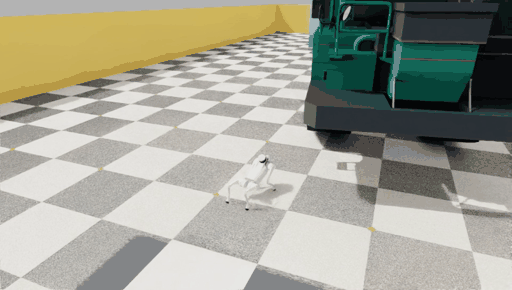

*Isaac Sim, 공사장. 크롤러 덤프트럭(높이 3.87 m) 옆에서 고개를 들고(pitch −25°) 옆으로 기울여(roll −15°) 적재함 위쪽을 스캔.*

## 4. 인식기 교체: Grounding DINO + SAM 2 (Grounded-SAM 2)

로봇 둘레 핀홀 카메라 4대(90°씩) → Grounding DINO(base) + SAM 2.1(large) → 라이다 점을 마스크에 투영(깊이로 가림 판정,
마스크 가장자리 2 px 침식, 바닥 반사점 제외) → 공간 묶음 + **다수결 클래스**로 물체 가설 (정답 ID 사용 안 함).
Co는 인식기가 붙인 클래스가 맞을 때만 센다.

**프롬프트 연구** (로봇 높이 카메라, 대상마다 8방향 × 3/6/10/15 m, [표 전체](results/pose_inspection/stage4_prompt_study.md))

| 클래스 | 단어 (단독) | 검출률 | 이미지당 오검출 |
|---|---|---|---|
| 지게차 | forklift / reach truck / industrial vehicle | 0.46 / 0.49 / 0.52 | 0.08 / 0.46 / 0.69 |
| 굴착기 | excavator / digger | 0.81 / 0.83 | 0.53 / 0.55 |
| 덤프트럭 (IC120 크롤러) | dump truck / crawler carrier | 0.81 / 0.79 | 0.85 / 0.93 |

단어를 **따로** 물으면 "excavator"가 크롤러 덤프트럭에도 박스를 친다(43장 중 35건). 공사장 두 클래스를 **한 질의
"excavator . tracked dump truck ."**에 넣으면 굴착기→덤프트럭 오인이 3건으로 줄고 덤프트럭 검출이 16 → 34/43으로 오른다.
6개 단어를 한 질의에 몰아넣으면 점수가 나뉘어 거의 아무것도 안 잡힌다.

**실험 이력 (Isaac, 6 seeds)** — 인식기는 같고, 라이다 점 → 물체 가설로 묶는 규칙만 바뀐다

| 버전 | 장면 | Co | t_eff [s] | N_post | 점 라벨 정밀도 / 재현율 | 무엇이 깨졌나 → 수정 |
|---|---|---|---|---|---|---|
| 정답 라벨 | 창고 / 공사장 | 0.78 / 0.63 | 520 / 300 | 12.7 / 6.7 | – | (3단계) |
| v0 | 창고 | 0.72 ± 0.04 | 1032 ± 100 | 23.5 | 지게차 0.60 / 0.77 | "박스에서 1.5 m 안이면 합류"가 연쇄로 번져 가설 하나가 여러 지게차 + 선반을 삼킴 (Co는 높지만 우연) |
| v0 | 공사장 | 0.34 ± 0.12 | 378 ± 71 | 8.2 | 덤프 0.42 / 0.92, 굴착기 0.81 / 0.11 | 같은 연쇄로 굴착기·덤프트럭·자재가 한 가설 → 다수결로 굴착기가 "덤프트럭" · 클래스별 최대 크기 |
| v1 | 공사장 | 0.43 ± 0.03 | 1136 ± 80 | 7.8 | 덤프 0.39 / 0.89, 굴착기 0.89 / 0.13 | 근접 사진(반사점 수천 개)에서 굴착기 하부 궤도가 "tracked dump truck"으로 읽혀 다수결을 독식 · 프레임당 1표 |
| v2 | 공사장 | 0.46 ± 0.02 | 774 ± 37 | 10.0 | 덤프 0.43 / 0.88, 굴착기 0.86 / 0.11 | 굴착기 b 0.73, 덤프트럭 0.50, **굴착기 a 0.00**: 기본 자세(붐 접힘) 굴착기는 어느 각도에서나 덤프트럭 표가 더 많음 → 인식기 한계 |
| v2 | 창고 | 0.35 ± 0.08 | 1200 (전부 시간 초과) | 18.2 | 지게차 0.59 / 0.76 | 크기 상한 때문에 지게차 하나가 여러 조각 가설로 쪼개지고, 선반 위 오검출(가설 중심 높이 4.5 m)도 가설이 됨 → 40개 한도가 차서 늦게 만난 지게차는 가설을 못 받음 |
| v3 | 창고 | 0.45 ± 0.07 | 1200 (전부 시간 초과) | 18.2 | 지게차 0.57 / 0.75 | 조각은 합쳐졌지만 가설 48개 중 37개가 **5 m 간격 선반 줄 위**: 마스크 구멍(지게차 마스트) 너머 선반이 찍힌다고 보고 → 마스크 중앙 깊이에서 2 m 넘게 먼 점 버림 (v4) |
| v3 | 공사장 | 0.46 ± 0.02 | 755 ± 57 | 8.8 | 덤프 0.43 / 0.88, 굴착기 0.87 / 0.11 | v2와 같음 |
| v4 | 창고 | 0.42 ± 0.06 | 1200 (전부 시간 초과) | 17.8 | 지게차 0.59 / 0.75 | 그대로: 선반 오검출은 구멍 너머가 아니라 **Grounding DINO가 선반·팔레트 자체를 "forklift"로 검출** |
| v4 | 공사장 | 0.42 ± 0.03 | 469 ± 101 | 8.3 | 덤프 0.53 / 0.89, 굴착기 0.86 / 0.12 | 가설 28 → 15개, 시간 −38 %, 하지만 접힌 굴착기는 여전히 0 |

마스크 자체는 정확하다(아래 그림, 노란 선 = 정답). 가설 관리(연쇄 묶기, 조각, 한도)는 v1–v3에서 규칙으로 고쳤지만, 남은 손실은
**검출기 단계**다: 공사장은 접힌 굴착기 ↔ 크롤러 덤프트럭(둘 다 궤도 차량) 혼동, 창고는 선반·팔레트를 "forklift"로 검출.
단어 선택(프롬프트 연구)과 후처리(v1–v4)로는 더 줄지 않았다. 다음 단계는 건설장비 데이터로 검출기를 미세조정하는 것이고,
7단계 RL 정책은 인식과 분리해 정답 라벨로 먼저 학습한다.


## 5. 로컬 VLM 가지치기

Qwen3-VL-8B-Instruct를 같은 프로세스의 별도 스레드에서 비동기로 돌린다. 장비마다 세션: 위에서 본 지도 크롭(번호 붙인
후보) + 구역 사진 최대 3장(이미 스캔한 부분 초록 틴트) + 후보 표 → `{"green_fraction", "keep", "confidence", "reason",
"done"}`. VLM은 후보만 고르고 각도·거리는 항상 3단계 기하 계산. 응답 시간만큼 시뮬레이션 시간이 지난 뒤에 판단이
적용되고, 그동안 로봇은 이전 판단으로 계속 움직인다. 실패·저신뢰·만료 시 "구역마다 최고 후보"로 돌아간다.

**최종 결과 (v5, Isaac 6 seeds, 정답 인식)** — [공사장 표](results/pose_inspection/stage5_B_isaac.md) · [창고 표](results/pose_inspection/stage5_A_isaac.md)

| 장면 | 방법 | AUCo ↑ | t_eff [s] ↓ | L_eff [m] | N_post | Co ↑ |
|---|---|---|---|---|---|---|
| 공사장 (T = 323 s) | POSE (모든 구역 방문) | 0.42 ± 0.09 | 300 ± 19 | 112 ± 14 | 6.7 | **0.63 ± 0.02** |
| | POSE + 기하 가지치기 | 0.35 ± 0.07 | 134 ± 21 | 65 ± 7 | 4.5 | 0.44 ± 0.07 |
| | VLM v4 (모델이 낸 초록 비율) | 0.35 ± 0.06 | 135 ± 14 | 74 ± 10 | 1.5 | 0.42 ± 0.06 |
| | **VLM v5 (지도에서 잰 초록 비율)** | **0.41 ± 0.04** | **215 ± 32** | 96 ± 20 | 3.5 | 0.56 ± 0.06 |
| 창고 (T = 548 s) | POSE (모든 구역 방문) | 0.43 ± 0.01 | 520 ± 20 | 205 ± 14 | 12.7 | **0.78 ± 0.02** |
| | POSE + 기하 가지치기 | 0.42 ± 0.07 | 223 ± 54 | 116 ± 27 | 6.0 | 0.52 ± 0.11 |
| | VLM v4 (모델이 낸 초록 비율) | **0.45 ± 0.03** | 286 ± 32 | 151 ± 22 | 4.2 | 0.58 ± 0.04 |
| | **VLM v5 (지도에서 잰 초록 비율)** | **0.45 ± 0.01** | 498 ± 29 | 221 ± 19 | 10.8 | 0.75 ± 0.03 |

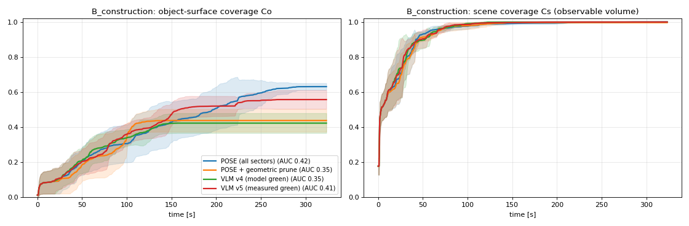 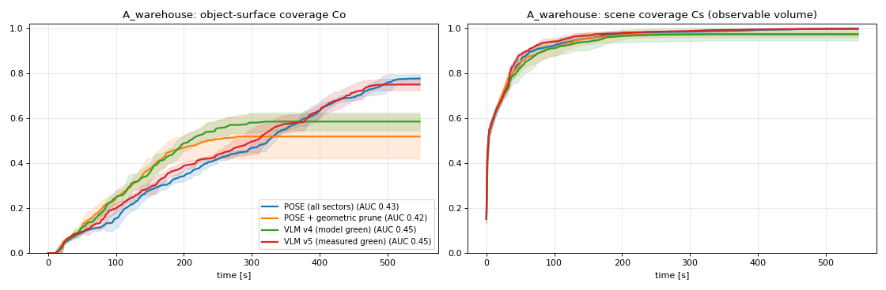

**읽는 법**
- 공사장에서 v5는 **POSE와 거의 같은 AUCo를 28 % 짧은 시간(300 → 215 s)**에 낸다. 굴착기 두 대는 0.81 / 0.81(전부 방문
  0.85 / 0.86)로 거의 다 보고, 손해는 덤프트럭(0.54 → 0.46)에서 난다. 같은 시간대의 기하 가지치기(0.44)보다 Co가 12 %p 높다.
- 창고에서는 v5가 거의 모든 구역을 남겨 시간 이득이 작다(−4 %). 지게차 7대가 비슷하게 생겨 "이쪽은 다 봤다"는 판단이
  잘 안 선다. AUCo 기준으로는 v4·v5 모두 POSE보다 조금 높지만 v4는 Co를 20 %p 잃는다.
- POSE 논문의 "VLM이 같은 커버리지를 더 빨리" 주장은 **공사장에서만** 재현됐다. 8B 로컬 모델이 할 수 있는 일은 "어느
  구역을 남길지" 고르는 데까지였고, "얼마나 봤는지"는 지도에서 재어 알려 줘야 했다.

**버전 이력 — 무엇이 깨졌고 어떻게 고쳤나**

| 버전 | 장면 | Co | t_eff [s] | 구역 방문 | VLM | 문제 → 수정 |
|---|---|---|---|---|---|---|
| v0 | 공사장 | 0.64 | 387 | 24 (전부) | 170회, 2.1 s | 방문마다 판단 만료 → 매번 다른 3개 → 결국 전부 방문 · POSE처럼 "남긴 구역 다 돌면 종료/재질의" |
| v1 | 공사장 | 0.63 | 361 | 17–24 | 75회, 2.3 s | 사진이 3 m 근접샷, 초록은 점무늬 → "대부분 초록" 판단 불가 · 4–8 m 사진, 면으로 칠한 틴트 |
| v2 | 창고 | 0.79 | 655 | 32–35 (전부) | 198회, 2.1 s, 오류 0 | 8B 모델이 "done"을 거의 안 함 (198회 중 5) · 모델이 낸 green_fraction ≥ 0.5면 코드가 "1개만 남기고 종료" 강제 |
| v3 | 공사장 / 창고 | 0.43 / 0.56 | 141 / 279 | 3–6 | 21회 / – | 이번엔 반대: 거의 항상 green 0.8 → 한 번 보고 종료. 초록이 "지도에 등록된 0.2 m 복셀"이라 멀리서 한 번 스쳐도 초록 · 초록 = d_max 안에서 반사점 20개 이상 찍힌 복셀 (v4) |
| v4 | 공사장 / 창고 | 0.42 / 0.58 | 135 / 286 | 1–4 | 19 / 66회 | 초록을 근접 스캔 복셀로 바꿨지만 여전히 한 번 보고 종료: 모델이 **t = 0(아무것도 안 봄)에도 green_fraction 0.8**을 답함 → 비율을 지도에서 재서 알려 주고 종료 판단도 그 값으로 (v5) |
| v5 | 공사장 / 창고 | 0.56 / 0.75 | 215 / 498 | – | 41 / 135회, 2.0 s, 오류 0 | (최종) |

로컬 VLM은 안정적(오류 0, 응답 2–3 s, 실행당 토큰 14–34 k)이지만, 그대로는 **가지치기를 거의 하지 않는다**. POSE는
GPT-5.4 + 프롬프트 안전장치로 이를 해결했는데, 8B 모델에서는 안전장치를 구조화된 출력으로 바꿔 코드에서 강제해야 한다.
v0–v3의 실패(전부 방문 / 한 번 보고 종료)는 **VLM에게 보여 준 "본 부분"의 정의** 문제였고, v4의 실패는 8B 모델이 그 비율을
**읽지 못한다**는 것이었다(아무것도 안 본 t = 0에 green_fraction 0.8). v5는 비율을 지도에서 재서 프롬프트에 넣고, 종료
안전장치도 그 값으로 판단한다. VLM은 남길 구역만 고른다.

## 6. 장비 형상 사전지식 — 클래스 템플릿 (결과: 효과 없음)

자세 이득이 세는 "아직 안 본 부분이 있을 영역"을 박스 부풀림(POSE) 대신 **클래스 템플릿**(굴착기 하부·상부·붐, 지게차
차체·마스트, 덤프트럭 적재함을 상자 조합으로; 하부 방향은 낮은 복셀 PCA, 붐 방향은 높은 복셀 또는 VLM)으로 예측해 봤다.

**Isaac Go2, 6 seeds, 모든 구역 방문**

| 장면 | 방법 | AUCo | t_eff [s] | N_post | Co |
|---|---|---|---|---|---|
| 창고 (T = 571 s) | 박스 (POSE) | 0.45 ± 0.01 | 520 ± 20 | 12.7 | **0.78 ± 0.02** |
| | 클래스 템플릿 | 0.43 ± 0.02 | 501 ± 19 | 10.3 | 0.75 ± 0.02 |
| | 템플릿 + VLM 붐 방향 | 0.44 ± 0.01 | 519 ± 36 | 9.0 | 0.74 ± 0.01 |
| | (참고) 박스 + 가지치기 G* < 5 | 0.48 ± 0.07 | 326 ± 53 | 12.3 | 0.65 ± 0.12 |
| 공사장 (T = 335 s) | 박스 (POSE) | 0.43 ± 0.09 | 300 ± 19 | 6.7 | 0.63 ± 0.02 |
| | 클래스 템플릿 | 0.44 ± 0.07 | 317 ± 9 | 11.7 | 0.63 ± 0.02 |
| | 템플릿 + VLM 붐 방향 | 0.44 ± 0.06 | 314 ± 15 | 10.7 | 0.63 ± 0.01 |
| | (참고) 박스 + 가지치기 G* < 5 | 0.44 ± 0.03 | 178 ± 16 | 5.8 | 0.55 ± 0.03 |

가지치기 행은 7단계 RL 정책의 비교 기준이다: 규칙으로 시점을 건너뛰면 빨라지지만 Co가 떨어지고(창고는 seed마다 0.47–0.77로
들쭉날쭉), RL이 이 교환을 더 잘 하는지가 7단계의 질문이다.

키네마틱에서 가지치기 임계값을 바꿔 가며 본 시간–커버리지 곡선도 같은 결론이다
([표 전체](results/pose_inspection/stage6_tradeoff.md)):

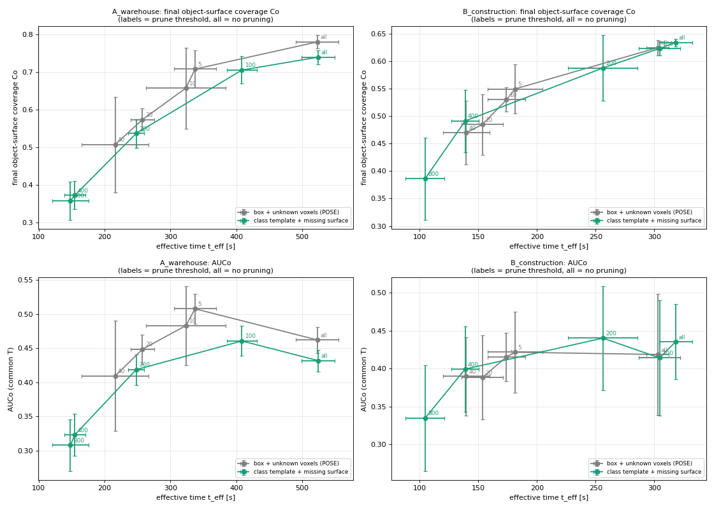

템플릿 껍질은 수평 자세로도 보이는 "덜 찍힌" 면까지 세서 수평 이득이 커지고, 그래서 기울임을 덜 고른다. 형상을 손으로
정한 규칙에 넣는 것으로는 이득이 없었고, **"어디를 언제 볼지"를 경험으로 배우게 하는 쪽(7단계 RL)**으로 방향을 바꿨다.

## 7. RL 탐사·검사 정책 — 머리를 학습시킨다

**무엇을 배우나.** 로봇이 다음 목표가 필요할 때마다, 플래너가 만든 후보 중 하나를 정책이 고른다. 후보는 1–5단계와 같다:
탐사 후보(아직 안 본 곳의 경계)와 장비 둘레 구역별 검사 시점(기울일 자세 포함). 여기에 **"그만"**도 선택지로 둔다.
걷기·자세·스캔은 그대로이고, 규칙 기반 머리의 "점수 + 최단 순서(TSP)" 자리만 정책으로 바뀐다.

| | 규칙 기반 (POSE, 1–5단계) | RL 정책 (7단계) |
|---|---|---|
| 다음 목표 | 모든 후보를 최단 순서로 다 돈다 | 후보 특징을 보고 하나를 고른다 (건너뛰기·순서·멈출 때를 학습) |
| 멈출 때 | 후보가 없고 지도가 더 안 늘 때 | 스스로 "그만" |
| 입력 | 이득 점수, 거리 | 후보마다 18개 특징(종류, 이동 시간, 방향, 자세 이득, 장비를 얼마나 가까이 봤나, 이미 본 구역 수 …) + 전체 6개 |

**보상.** 결정 하나마다 `10 × (새로 본 장비 표면 비율) − 0.5 × (걸린 시간 / 100 s)`. 표면은 학습 때만 정답으로 센다
(정책 입력에는 정답이 없다). 결국 AUCo — 빨리, 많이 보기 — 를 키우는 쪽으로 배운다.

**어떻게 학습하나.** 빠른 키네마틱 엔진에서 PPO. 같은 장면을 외우지 않도록 **매 반복 새 장면을 랜덤으로 만든다**
(창고형: 랙 줄 수·높이·통로 폭·지게차 3–8대 / 야적장형: 굴착기 두 자세·덤프트럭 1–4대 + 자재). 장비 메시는 1단계
장면에서 잘라 온 것이고, 손으로 만든 창고·공사장 두 장면은 학습에 쓰지 않는다(시험용).

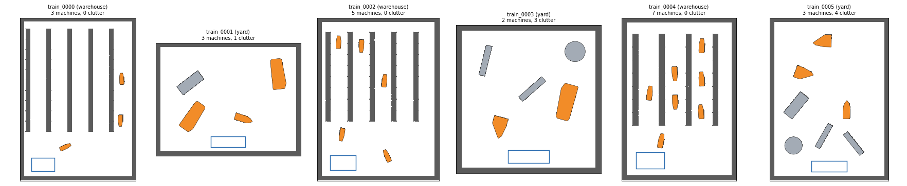

*랜덤 장면 예시 (주황 = 대상 장비, 회색 = 자재, 파란 상자 = 출발 구역).*

**평가.** 학습에 안 쓴 랜덤 장면 20개 + 손으로 만든 두 장면에서, 같은 시작점으로 규칙 기반 POSE와 AUCo · Co · 시간을 비교
(`rl_eval.py`). 이어서 Isaac Go2(실제 보행 정책)로 확인한다.

### 결과: Isaac Go2 (실제 보행 정책), 손으로 만든 두 장면 (학습에 한 번도 안 씀), 6 seeds

정책 = run1 120번째 반복(`results/pose_inspection/rl/policies/run1_it120.pt`), greedy. 나머지(보행·자세·스캔·정답 라벨)는
1–5단계와 같다. 비교 대상은 같은 장면·같은 시작점의 Isaac 결과.

| 장면 | 방법 | AUCo ↑ | t_eff [s] ↓ | L_eff [m] | N_post | Co ↑ | Co / 상한 |
|---|---|---|---|---|---|---|---|
| 공사장 (T = 300 s) | POSE (규칙, 모든 구역) | 0.42 ± 0.09 | 300 ± 19 | 112 ± 14 | 6.7 | **0.63 ± 0.02** | 0.78 |
| | POSE + 기하 가지치기 (G* < 5) | 0.43 ± 0.03 | 178 ± 16 | 83 ± 8 | 5.8 | 0.55 ± 0.03 | 0.69 |
| | POSE + VLM v5 | 0.41 ± 0.04 | 215 ± 32 | 96 ± 20 | 3.5 | 0.56 ± 0.06 | 0.69 |
| | **RL 정책** | **0.50 ± 0.02** | **193 ± 20** | **83 ± 9** | 3.5 | 0.62 ± 0.02 | 0.77 |
| 창고 (T = 520 s) | POSE (규칙, 모든 구역) | 0.43 ± 0.01 | 520 ± 20 | 205 ± 14 | 12.7 | **0.78 ± 0.02** | 0.83 |
| | POSE + 기하 가지치기 (G* < 5) | 0.47 ± 0.07 | 326 ± 53 | 150 ± 27 | 12.3 | 0.65 ± 0.12 | 0.70 |
| | POSE + VLM v5 | 0.45 ± 0.01 | 498 ± 29 | 221 ± 19 | 10.8 | 0.75 ± 0.03 | 0.80 |
| | **RL 정책** | **0.50 ± 0.03** | 431 ± 45 | 201 ± 16 | 12.7 | 0.75 ± 0.04 | 0.81 |

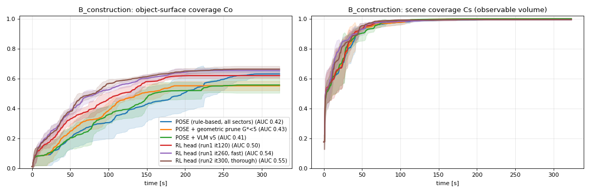 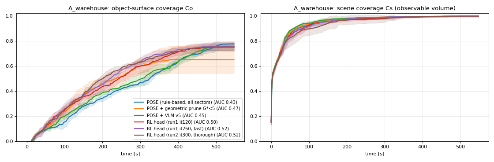

- **두 장면 모두 AUCo 1위.** 공사장은 POSE와 거의 같은 Co(0.62 vs 0.63)를 **36 % 짧은 시간**에 낸다. 같은 시간대의 가지치기·VLM은
  Co를 7–8 %p 잃었는데 RL은 1 %p. 창고는 17 % 빠르고 Co는 3 %p 낮다.
- 키네마틱에서 학습한 정책이 Isaac Go2(실제 보행 정책, 자세 추종 오차)로 그대로 옮겨졌다. 충돌·넘어짐 없음.
- 정책이 배운 것(실행 기록에서): 장비가 보이면 탐사 경계보다 **장비 시점을 먼저** 가고, 이미 가까이 본 장비의 남은 구역은
  건너뛰며, 지도가 거의 다 차면 **스스로 멈춘다**. POSE는 TSP 순서대로 모든 구역을 돈 뒤 지도가 정체돼야 끝난다.

### 학습 중 평가 (run1 · 학습에 안 쓴 랜덤 장면 10개 · 장면마다 같은 시작점 4개 · 키네마틱)

| 장면 종류 | | AUCo ↑ | 최종 Co | t_eff [s] | RL이 멈춘 시각에 POSE가 본 Co | RL 최종 Co까지 POSE가 걸린 시간 |
|---|---|---|---|---|---|---|
| 창고형 5개 | POSE (규칙) | 0.535 | **0.83** | 532 | | |
| | RL 30번째 반복 | 0.587 | 0.72 | 295 | 0.59 | 381 s |
| | **RL 120번째 반복** | **0.593** | 0.77 | **327** | 0.65 | 425 s (RL보다 +30 %) |
| 야적장형 5개 | POSE (규칙) | 0.531 | **0.82** | 219 | | |
| | RL 30번째 반복 | 0.600 | 0.76 | 124 | 0.59 | 169 s |
| | **RL 120번째 반복** | **0.585** | 0.79 | **147** | 0.66 | 179 s (RL보다 +22 %) |

- 10개 장면 **모두** AUCo가 POSE보다 높다. 단순히 일찍 멈춰서가 아니라 **같은 시각에 더 많이 본다**: RL이 멈춘 순간
  POSE는 0.65, RL은 0.77–0.79. 같은 커버리지에 POSE보다 **18–23 % 빨리** 도달한다.
- 학습이 진행되며 "너무 일찍 그만"이 줄었다(최종 Co 0.72 → 0.77). 그래도 끝까지 보는 POSE(0.82)보다 4–6 %p 낮다 →
  보상의 시간 가중치를 0.5 → 0.2로 낮춘 **run2**를 함께 학습 중("끝까지 다 보되 더 빨리").
- 학습 곡선: 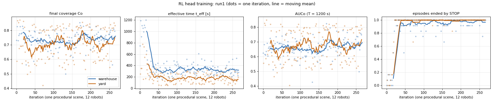

| 구성 요소 | 파일 |
|---|---|
| 랜덤 장면 생성 (부품 라이브러리 + 배치) | `go2_lab/pose_inspection/rl/procgen.py`, `scripts/pose_inspection/rl_make_scenes.py` |
| 정책 입력 (후보 18 + 전체 6 특징) | `go2_lab/pose_inspection/rl/features.py` |
| 정책 (후보끼리 어텐션 + "그만" 토큰, actor-critic) | `go2_lab/pose_inspection/rl/policy.py` |
| 학습 (PPO, 시간 할인 semi-MDP) / 평가 | `scripts/pose_inspection/rl_train.py`, `rl_eval.py`, `configs/pose_inspection/rl.yaml` |

---

## POSE와 다른 점

| 항목 | POSE | 여기 | 이유 |
|---|---|---|---|
| 로봇 | 키네마틱 Spot, ±30° / ±20° | Isaac Go2 + 자세 보행 정책, ±25° / ±15° | 정책 학습 범위 |
| 라이다 | ±22.5° | VLP-16 ±15° (15° 기울여 장착, 0°는 비교군) | 실제 장비 |
| 종료 | Cs > 90 % & 30 s 정체 | 같은 조건 + **플래너에 남은 목표 없음**; 목표가 없고 Cs가 정체면 90 % 미만이어도 종료 | 트인 공사장은 Cs가 1분 만에 포화; 강한 가지치기 후 1200 s 대기 방지 |
| Cs 분모 | 전체 복셀 | 관측 가능한 부피 (상한 계산으로 구함), 원래 값도 기록 | 막힌 내부 제외 |
| 물체 발견 | d_max 6 m | 발견 20 m (모델·시점 생성), Co는 6 m 이내 반사점만 | 트인 현장에서 6 m 안에 안 들어가면 장비를 못 찾음 |
| VLM | GPT-5.4 API + heartbeat, 모델이 커버리지 판단 | 로컬 Qwen3-VL-8B, 방문·만료 시 재질의, **초록 비율은 지도에서 측정해 제공** | API 미사용 조건; 8B 모델은 비율을 못 읽음 |
| 라이다 | Isaac 센서 | 같은 패턴을 warp로 직접 ray cast (삼각형 ID → 정답 분할) | 정확한 GT 분할 |

## 실행

```bash
conda activate isaac && cd sim
scripts/pose_inspection/fetch_assets.sh Assets/Isaac/6.1/Isaac/Robots/IsaacSim/ForkliftB/   # Isaac 에셋 받기
python scripts/pose_inspection/build_scenes.py                     # 1단계: 장면 생성
python scripts/pose_inspection/compute_upper_bound.py              # 2단계: 이론 상한
python scripts/pose_inspection/run_isaac.py --exp exp/pose.yaml --scene A_warehouse   # 3단계 (6 seeds 병렬)
scripts/pose_inspection/run_isaac_batch.sh "pose planar" "A_warehouse B_construction"
python scripts/pose_inspection/aggregate.py --engine isaac --conds pose planar --name stage3
python scripts/pose_inspection/run_kinematic.py --exp exp/pose.yaml --scene B_construction  # 빠른 개발용 엔진
```

모든 파라미터는 [`configs/pose_inspection/`](configs/pose_inspection/) YAML (`base.yaml` + 장면 + `exp/` 조건별 덮어쓰기).

| 경로 | 내용 |
|---|---|
| `go2_lab/pose_inspection/` | scene_builder · raycast · metrics · upper_bound · mapping · viewpoints · navigation · agent · session · kinematic · isaac_env · perception · vlm · vlm_pruner · priors |
| `scripts/pose_inspection/` | 장면 생성, 상한, 실행(키네마틱 / Isaac), 집계, 프롬프트 연구, GIF |
| `results/pose_inspection/` | 단계별 JSON · 표(md) · 그림, 실행별 seed JSON |

이전 작업(①–⑤ 보행, ARiADNE 탐사 재학습, BIM 사전정보)은 [`bim` 브랜치 README](https://github.com/gkgk0119gmail-arch/3DOG_Go2-exploration/tree/bim).

## 출처

- POSE: Zhan, Chen, Shimada, *Pose-aware Legged Robot Semantic Exploration with Omnidirectional Perception in Confined
  Unknown Environments*, arXiv 2609.19460 (2026)
- Grounding DINO (IDEA-Research/grounding-dino-base), SAM 2.1 (facebook/sam2.1-hiera-large), Qwen3-VL-8B-Instruct
- 장비: ix35e 미니 굴착기 URDF, PWRI IC120 크롤러 덤프트럭 (Apache-2.0), NVIDIA Isaac Sim 창고·ForkliftB 에셋
- [Isaac Lab](https://github.com/isaac-sim/IsaacLab) 3.0, Isaac Sim 6.0.1
